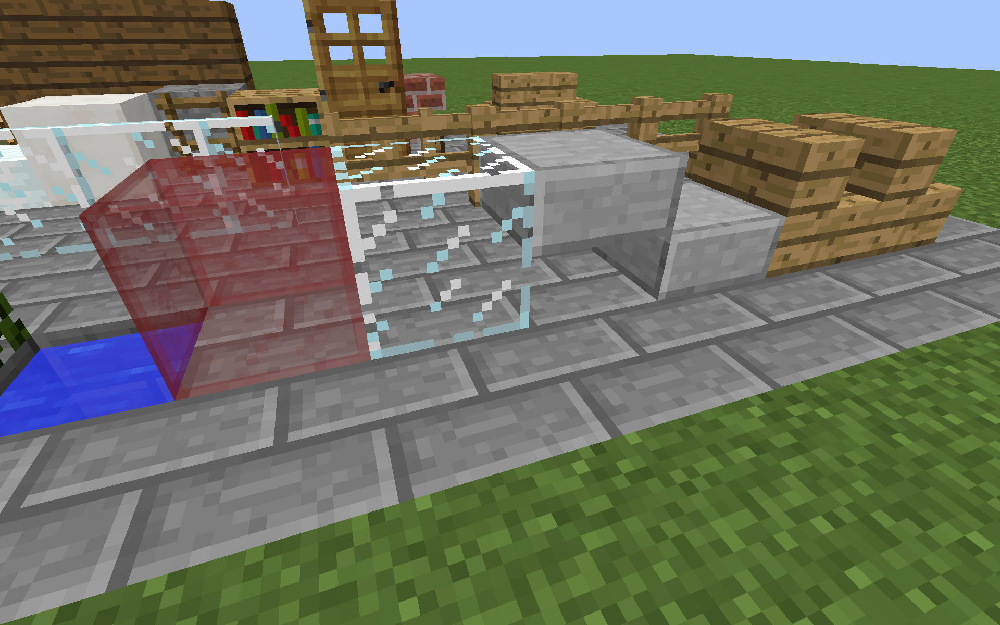
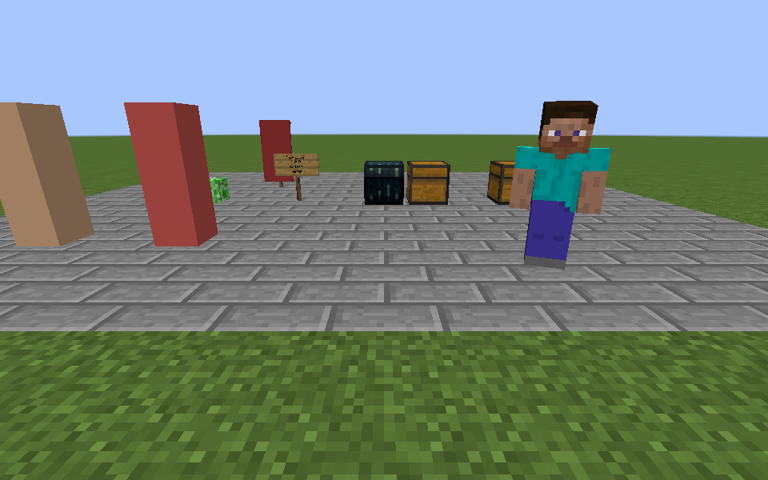
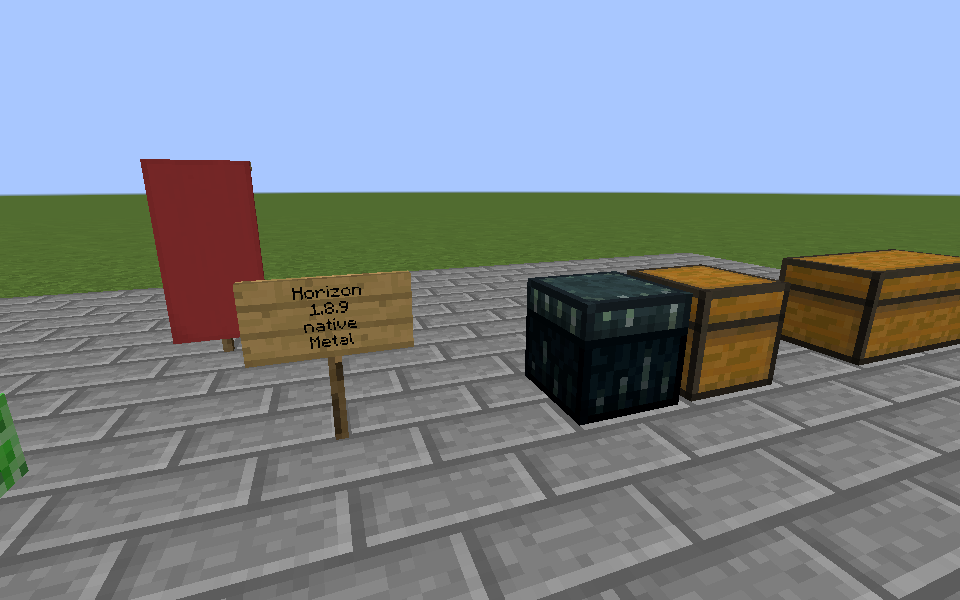

<h1 align="center">Horizon 1.8.9</h1>

<p align="center">
  <b>A native Minecraft 1.8.9 client in Rust and Apple Metal.</b><br>
  Protocol 47, vanilla-exact movement and the full 1.8.9 block registry. No Java, no LWJGL, no OpenGL.
</p>

<p align="center">
  
</p>

<p align="center">
  
  
</p>

<p align="center"><sub>Every frame above was rendered by this client and captured from its Metal surface, connected to an official 1.8.9 server.</sub></p>

## What it does

- **Connects like 1.8.9.** Protocol 47 framing, zlib compression, AES/CFB8 encryption, Microsoft → Xbox Live →
  Minecraft sign-in (or offline/direct-token modes for testing), keep-alives and every movement packet in
  vanilla's order.
- **Moves like 1.8.9.** A line-by-line port of `EntityPlayerSP`: the legacy 65536-entry sine table, float
  rounding and double promotions, sprint/sneak/jump rules, step-up, sneak-edge clipping, ladders, water flow,
  lava, cobwebs, soul sand, ice, slime, Depth Strider, flight, knockback, potions and attribute modifiers in
  Java `HashSet` order.
- **Draws 1.8.9.** All 198 block IDs and 2,557 blockstate variants from your own game jar, with neighbour
  states (stairs, fences, panes, walls, doors), biome tints, flat lighting with client skylight, cutout and
  sorted translucency, mipmaps and fog. Players with armor, held blocks/items, names, skin/cape bindings and hurt feedback; thirteen common mob types;
  chests, signs with text, skulls and banners. Additional entity variants remain in progress.
- **Accepts real play input.** User-driven attacks and interactions, sword blocking, hotbar selection,
  survival/creative digging, block placement, and basic inventory/container pickup transactions. The local
  vanilla gate confirms attack hurt status, placement/mining, chest interaction and spectator wall traversal.
  Exact item transforms, special-container rules and remaining selection shapes are still in progress.
- **Feels native on a Mac.** winit + wgpu forced to the Metal backend on Apple Silicon, Retina-aware, raw
  mouse deltas with vanilla sensitivity, keyboard state reconciled against the window server, and meshing on
  its own thread so the 20 TPS simulation never waits.

## How it is verified

Parity claims are checked against the real game, not against expectations:

| Check | How |
| --- | --- |
| Collision boxes | Stair corners compared with the official 1.8.9 server jar on all 52,488 neighbour configurations (`stairs_probe` example vs. a reflection harness). AABB clipping matched 1.8.9 bytecode on 15,000 cases. |
| Movement | Scripted walk, sprint, sprint-jump, sneak, strafe and flight against a local official 1.8.9 server, which re-simulates every move: zero "moved wrongly" or "moved too quickly" flags. |
| Physics figures | Unit tests pin walking (0.21586 blocks/tick), sprinting (0.28062), the 1.8.9 jump apex (1.249187…), step-up, sneak edges, flight and Depth Strider. |
| Rendering | Every metadata state binds a blockstate variant from the owned jar; Metal frames are read back and inspected. |

## Architecture

```
            winit (AppKit)                    Protocol 47 actor (50 ms ticks)            Mesher thread
  keys ─► keyboard.rs ─┐                ┌─► horizon-physics-189 player tick ─► C03/C0B/C13
  mouse ─► look ───────┼─► Shared ──────┤   horizon-world-189 World ◄─ chunks, block changes
                       │   (keys, pose, │   entities, block entities                   │
  Metal ◄─ scene.rs ◄──┘    entities)   └─► dirty columns ─────────────────────────────►├─ terrain.rs + models.rs
         per-column buffers ◄──────────────────────────────── MeshUpdate ◄──────────────┘
```

| Crate | Role |
| --- | --- |
| `horizon-protocol-47` | Transport, login, play primitives, entities, bounded NBT, slots, metadata |
| `horizon-world-189` | Legacy chunk storage, heightmap skylight, block registry, blockstate selection, entity tracking |
| `horizon-physics-189` | Exact AABB clipping, collision shapes, the local player tick |
| `horizon-assets-189` | Reads blockstates, models and textures from your own 1.8.9 jar |
| `horizon-auth` | Microsoft/Xbox/Minecraft sign-in, memory-only sessions |
| `horizon-189-client` | Window, input, network actor, mesher, Metal renderer |

The 1.8.9 crates live beside the [Horizon](https://github.com/horizon-rust/horizon) workspace (a Rust rewrite
of Minecraft 26.3) and reuse its numeric geometry, model baking and platform layers, while keeping every
legacy algorithm in its own crate.

## Build and run

Requirements: an Apple Silicon Mac, Xcode command-line tools, Rust (stable, `aarch64-apple-darwin`), and your
own copy of Minecraft: Java Edition with the 1.8.9 version installed in the official launcher. Game assets
are read from your local jar at run time and are never part of this repository.

```sh
git clone https://github.com/Bobshiona/horizon-1.8.9.git
cd horizon-1.8.9
cargo build --release -p horizon-189-client --target aarch64-apple-darwin

# Offline, against a local 1.8.9 server in offline mode:
target/aarch64-apple-darwin/release/horizon-189-client --offline --username Steve --server 127.0.0.1

# Signed in with your Microsoft account:
target/aarch64-apple-darwin/release/horizon-189-client --login --server <host>
```

| Option | Meaning |
| --- | --- |
| `--assets JAR` | 1.8.9 jar to read (defaults to the launcher's install) |
| `--render-distance N` | View distance in chunks, 2–16 (default 8) |
| `--sensitivity F` | Mouse sensitivity 0.0–1.0 (vanilla default 0.5) |
| `--help` | Every option |

Controls: the cursor captures on join; **WASD** move, **Space** jumps (double-tap to fly where allowed),
**Shift** sneaks, **Control** or **Left Option** sprints, **Escape** releases the cursor.

`--login` signs in with a Microsoft device code; tokens stay in memory and are never written to disk or logs.
It uses a public Microsoft client ID unless `HORIZON_MSA_CLIENT_ID` names your own approved Azure app
registration. Horizon's own registration is never used.

## Roadmap

- [x] Protocol 47 transport, encryption, compression, login and sign-in
- [x] Full 1.8.9 block registry and Metal terrain renderer
- [x] Vanilla-exact local player movement, collision and flight
- [x] Players, entities and block entities
- [ ] Combat and interaction: attacks, item use, block placing and digging
- [ ] Inventory, hotbar and HUD; held items and armour on players
- [ ] Nametags, chat and real skins
- [ ] Mob models, smooth lighting, animated textures
- [ ] Signed release builds

## Credits and licence

This is an unofficial fork of [horizon-rust/horizon](https://github.com/horizon-rust/horizon) and keeps its
licence: GNU LGPL-3.0 ([LICENSE](LICENSE), with the GPL-3.0 text in [LICENSES/](LICENSES)) and the
[third-party notices](THIRD_PARTY_NOTICES.md). The 1.8.9 client is new work in the `horizon-*-189`,
`horizon-protocol-47`, `horizon-auth` and `horizon-client-platform` crates; the rest of the workspace is
Horizon's, described in its [original README](docs/horizon-upstream-README.md). It is not affiliated with or
endorsed by the Horizon project.

<sub>NOT AN OFFICIAL MINECRAFT PRODUCT. NOT APPROVED BY OR ASSOCIATED WITH MOJANG OR MICROSOFT. Minecraft is a
trademark of Mojang Synergies AB; its code and assets belong to Mojang and Microsoft under the
[Minecraft EULA](https://www.minecraft.net/en-us/eula).</sub>
